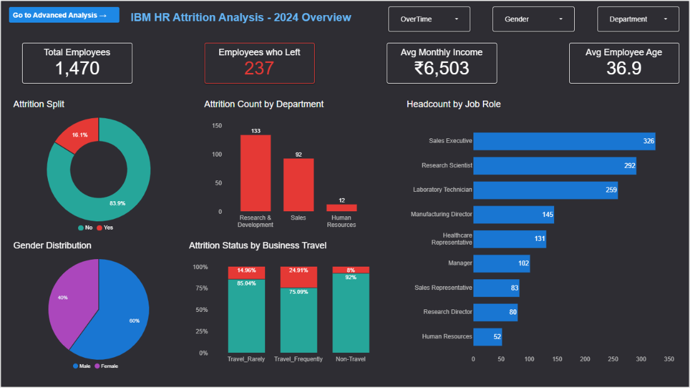
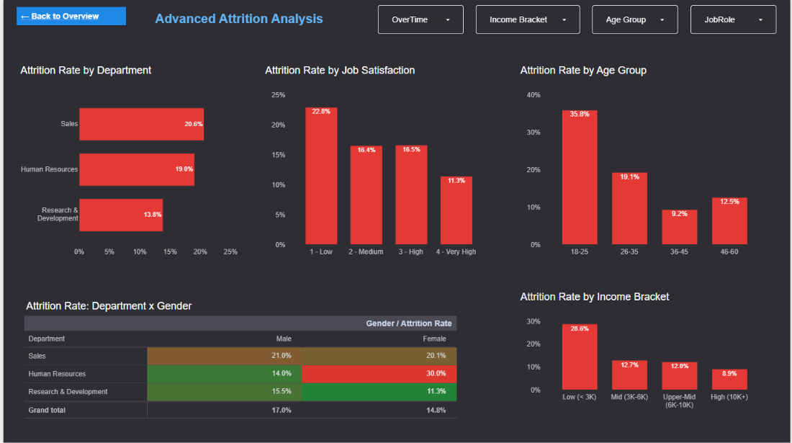

# IBM HR Attrition Analysis Dashboard

An interactive 2-page dashboard built in Google Data Studio (Looker Studio) that shows who leaves, where, and how often, using the IBM HR Analytics sample dataset (1,470 employees).

**[View the live dashboard](https://datastudio.google.com/reporting/de210e6d-390c-498b-8c4d-6d9c4aec04ba)** (view only)

## Preview

**Page 1: HR Overview**

**Page 2: Advanced Attrition Analysis**

## Key findings

| Factor | Highest-risk group | Rate | Lowest-risk group | Rate |
|---|---|---|---|---|
| Overtime | Works overtime | 30.5% | No overtime | 10.4% |
| Age group | 18-25 | 35.8% | 36-45 | 9.2% |
| Income bracket | Low (< 3K) | 28.6% | High (10K+) | 8.9% |
| Business travel | Travel_Frequently | 24.9% | Non-Travel | 8.0% |
| Job satisfaction | 1 - Low | 22.8% | 4 - Very High | 11.3% |
| Department | Sales | 20.6% | R&D | 13.8% |

Overall: 237 of 1,470 employees left (16.1%). Full analysis and recommendations are in [`report/`](report/IBM_HR_Attrition_Insights_and_Recommendations.docx).

## What's in the dashboard

**Page 1 (overview):** 4 KPI cards, attrition split donut, attrition count by department, headcount by job role, gender distribution, and attrition by business travel (100% stacked). Filters: OverTime, Gender, Department.

**Page 2 (advanced analysis):** attrition rate by department, job satisfaction, age group and income bracket, plus a Department x Gender pivot table with a green-to-red colour scale. Filters: OverTime, Income Bracket, Age Group, JobRole.

## Calculated fields

| Field | Logic |
|---|---|
| Attrition Flag | 1 if Attrition = Yes, otherwise 0 |
| Attrition Rate | Leavers divided by employees |
| Age Group | 18-25, 26-35, 36-45, 46-60 |
| Income Bracket | Low (< 3K), Mid (3K-6K), Upper-Mid (6K-10K), High (10K+) |
| Satisfaction Level | JobSatisfaction 1-4 as Low, Medium, High, Very High |

## Tools

Google Data Studio (Looker Studio), Google Sheets, calculated fields, filter controls, conditional formatting.

## Repository contents

- `data/`: the dataset used
- `report/`: written insights and recommendations (Word)
- `screenshots/`: dashboard previews

## Notes

- The findings show association, not causation, and some segments are small (for example HR female, n=20).
- The dataset is a publicly available HR sample dataset, so the results illustrate the analysis method and are not a real company's data.

## Author

Md Ziaul Haque
